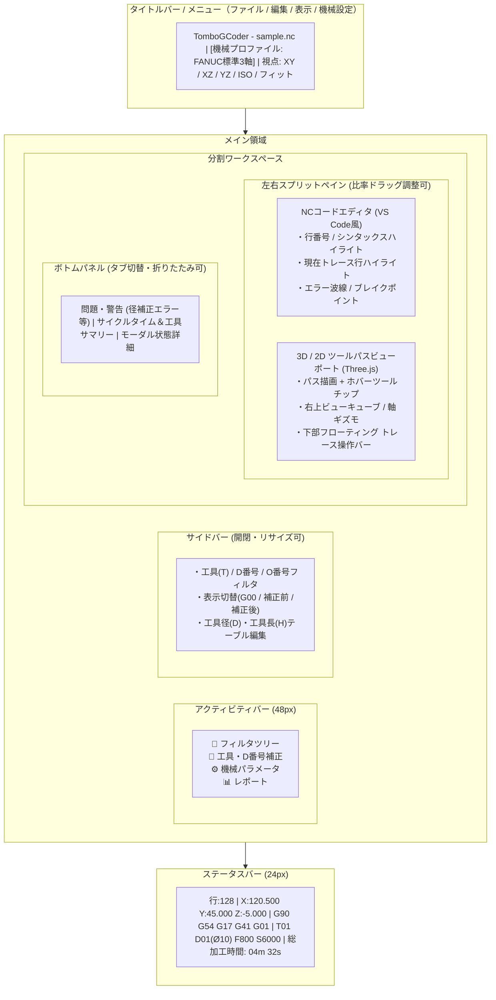

# プロジェクト要件定義書：TomboGCoder

株式会社システムアイ製「NC Viewer」の操作感・検証能力をベンチマークとした、**FANUC 3軸マシニングセンタ向けデスクトップNCビューア＆事前検証アプリ**の要件定義書（確定版）。

---

## 1. 決定済みプロジェクト前提

| 項目 | 決定内容 |
|---|---|
| **アプリ名** | `TomboGCoder` |
| **形態・対象OS** | クロスプラットフォーム・デスクトップアプリ（**macOS** で開発・動作確認し、**Windows** 向けにもビルド・動作） |
| **対象加工・制御装置** | **3軸ミル加工（FANUC系Gコード標準）** にフォーカス（※旋盤・ワイヤー・4軸は将来拡張枠） |
| **MVPの3大コア機能** | ① **トレース（ステップ実行・双方向同期）** ② **工具径補正（G40/G41/G42）** ③ **サイクルタイム算出** |
| **UIデザイン** | **VS Code風**のモダンなダークテーマ＆ペイン分割レイアウト（アクティビティバー／サイドバー／エディタ＋3Dビュー／ボトムパネル／ステータスバー） |
| **推奨技術スタック** | **Tauri v2 + React + TypeScript + Three.js**（ローカルに Node v25 / Rust 1.93 環境導入済みのため即時構築可能） |

---

## 2. 機能要件（優先度確定版）

### 2.1 NCプログラム解析エンジン（FANUC 3軸ミル）

| 機能 | 詳細仕様 | 優先度 |
|---|---|---|
| **基本移動・補間** | `G00`（早送り）、`G01`（直線補間）、`G02`/`G03`（円弧補間：`I/J/K`・`R`指定・全円・ヘリカル補間）、`G04`（ドウェル）、`G17`/`G18`/`G19`（平面選択）、`G90`/`G91`（アブソリュート/インクリメンタル）、`G20`/`G21`（インチ/ミリ） | **Must (P1)** |
| **座標系・工具長補正** | ワーク座標系（`G54`〜`G59`, `G54.1 P1〜`）、座標系設定（`G92`）、ローカル座標系（`G52`）、機械座標選択（`G53`）、原点復帰（`G28`/`G30`）、工具長補正（`G43`/`G44`/`G49`＋`H`番号） | **Must (P1)** |
| **固定サイクル** | `G73`, `G74`, `G76`, `G80`〜`G89`（穴あけ・深穴・タップ・ボーリング）、`G98`/`G99`（イニシャル点/R点復帰）、`R`/`Z`/`Q`/`P`/`K`（繰返し回数）の軌跡展開 | **Must (P1)** |
| **工具径補正（G40/G41/G42）** | ・`D`番号ごとの工具径テーブル管理（手動入力＋コメント自動抽出） ・スタートアップ／キャンセル／コーナー処理（内角交点計算、外角の伸長・円弧挿入） ・`G17`/`G18`/`G19` 平面対応、複数ブロック先読み（非移動ブロックのスキップ処理） ・過切込・干渉・内Rより大きい工具径などの**補正エラー検出と警告表示** ・補正前（プログラムパス）と補正後（工具中心パス）の重ね表示／切替 | **Must (P1)** |
| **構文・異常チェック** | 始終点半径不一致の円弧、`R`不足、径補正干渉、未対応コードなどのエラー／警告リスト生成（クリックで該当行へジャンプ） | **Must (P1)** |
| **サブプログラム対応** | `M98`/`M99`（繰返し回数 `L` / `P` 指定）、同一ファイル内 `O` 番号呼出、外部ファイル参照 | Should (P2) |
| **カスタムマクロB** | 変数（`#1`〜`#33`, `#100`〜, `#500`〜）、演算・三角関数、`IF`/`GOTO`/`WHILE`/`DO`/`END`、`G65`/`G66`/`G67` | Should (P2) |
| **コメントからの工具情報抽出** | `(T1 D10.0 ENDMILL)` 等のコメントから正規表現ルールで工具径・工具名・D番号を自動抽出 | Should (P2) |

### 2.2 トレース・デバッグ＆ナビゲーション

| 機能 | 詳細仕様 | 優先度 |
|---|---|---|
| **ステップ＆自動トレース** | 1ブロック送り／戻し、連続再生・一時停止、再生速度調整（低速〜超高速）、シークバーによる任意ブロックへの瞬時ジャンプ | **Must (P1)** |
| **コード⇔パス双方向同期** | トレース中・クリック選択中のブロックをエディタ行と3Dビュー上のパス双方でハイライト。現在位置に工具インジケータ（簡易3Dエンドミル/クロスヘア）を表示 | **Must (P1)** |
| **ホバー・ツールチップ** | 3Dビュー上のパスにマウスを重ねると、行番号・Gコード・始点/終点・移動量・F/S/T/D値・円弧R/中心を即時ツールチップ表示 | **Must (P1)** |
| **ブレイクポイント機能** | エディタガターをクリックして任意行に設定、および条件自動ブレイク（工具交換 `T`/`M06`、Zマイナス突入、`G00`、エラー発生時など） | Should (P2) |
| **スナップ計測機能** | パスの端点・中点・円弧中心にスナップして2点間距離（`dX`, `dY`, `dZ`, 直線距離）、円弧半径・中心座標を計測 | Should (P2) |

### 2.3 サイクルタイム算出＆解析レポート

| 機能 | 詳細仕様 | 優先度 |
|---|---|---|
| **機械パラメータ設定** | 早送り速度（X/Y/Z軸別）、工具交換（ATC）所要時間、主軸加減速／コーナー加減速係数、最小ブロック処理時間などを機械プロファイルとして保存 | **Must (P1)** |
| **サイクルタイム算出** | 早送り時間・切削送り時間・固定サイクル時間・ドウェル（`G04`）・工具交換時間を積算し、**全体および工具別（T番号別）の加工時間**を算出 | **Must (P1)** |
| **加工サマリー表示** | 使用工具一覧、工具別の切削距離・早送り距離・加工時間・最小Z値、ワーク全体バウンディングボックス（X/Y/Zの最小〜最大値）を表形式で表示 | **Must (P1)** |
| **レポート出力** | サマリー表の CSV / HTML / PDF エクスポート | Should (P2) |

### 2.4 3D / 2D ビジュアライゼーション＆表示フィルタ

| 機能 | 詳細仕様 | 優先度 |
|---|---|---|
| **高速GPU描画（Three.js）** | `BufferGeometry` 統合描画により、10万〜50万ブロック級でも滑らかに操作可能 | **Must (P1)** |
| **カメラ・視点操作** | 回転・パン・ズーム、視点プリセット（上面XY・正面XZ・側面YZ・アイソメトリック）、平行投影／透視投影切替、全体フィット | **Must (P1)** |
| **パス種別・工具別色分け** | 早送り（破線/赤系）、直線切削（実線/シアン系）、円弧（緑系）、固定サイクル（黄系）、径補正前/後パス、工具別カラーリング | **Must (P1)** |
| **表示フィルタ** | 工具番号（T）、径補正番号（D）、プログラム番号（O）、早送り表示ON/OFF、径補正前/後パス表示切替 | **Must (P1)** |
| **4面図・Zスライス・工具径塗りつぶし** | 3面図＋ISO同時表示、Z範囲フィルタ、2Dポケット削り残し確認用の工具径幅塗りつぶし描画 | Should (P2) |
| **DXFリファレンス照合＆出力** | DXF下図の重ね表示（干渉・削り込み目視チェック）、解析パスのDXF/CSVエクスポート | Could (P3) |

### 2.5 エディタ＆デスクトップ連携

| 機能 | 詳細仕様 | 優先度 |
|---|---|---|
| **VS Code風NCコードエディタ** | 行番号、G/Mコードのシンタックスハイライト、検索・置換、編集後の即時再解析・再描画、ファイル保存 | **Must (P1)** |
| **ローカルファイル操作** | ネイティブのファイル開く／ドラッグ＆ドロップ、文字コード自動判別（UTF-8 / Shift-JIS） | **Must (P1)** |
| **外部エディタ連動（ファイル監視）** | 外部エディタでファイルが保存された際に自動リロードし、視点・フィルタ状態を維持したまま再描画 | Should (P2) |

---

## 3. VS Code風 UIレイアウト設計

---

## 4. 技術アーキテクチャ構成

### 採用スタック
- **デスクトップシェル**：**Tauri v2**（macOS `.app`/`.dmg`・Windows `.msi`/`.exe` 両対応、軽量・高速）
- **フロントエンドUI**：**React 19 + TypeScript + Vite + Tailwind CSS**（VS Code風ダークカラーパレット＆パネル分割）
- **コードエディタ**：**CodeMirror 6**（または **Monaco Editor**）※軽量さ・起動速度とカスタマイズ性の高さから **CodeMirror 6** が有力、VS Code完全再現なら Monaco Editor
- **3D描画**：**Three.js**（カスタム `BufferGeometry` + 空間ハッシュ/BVHによる高速ホバーピッキング）
- **NC解析・径補正・サイクルタイムエンジン**：
  - **Rust（Tauriバックエンド）** または **TypeScript（Web Worker）** のいずれかで純粋ロジック層として分離設計。
  - **推奨は Rust コア**：ローカルに Rust 1.93 が導入済みであり、Shift-JIS読込・大規模ファイル高速パース・倍精度（`f64`）での工具径補正演算・ファイル監視を一貫して爆速かつ堅牢に実装できる。

---

## 5. 段階的開発ロードマップ

### Phase 1：MVP（3軸FANUC・トレース・径補正・サイクルタイム）
1. **プロジェクト基盤構築**：Tauri v2 + React + TS + Three.js の雛形作成とVS Code風シェルUI構築
2. **NCパーサ＆シミュレータコア**：FANUC 3軸基本Gコード・座標系・固定サイクル・モーダル状態追跡
3. **工具径補正エンジン（G40/G41/G42）**：D番号テーブル、スタートアップ/コーナー/キャンセル演算、干渉エラー検出、補正前後パス出力
4. **サイクルタイム＆サマリー算出**：機械パラメータに基づく全体・工具別の加工時間・移動距離・XYZ範囲計算
5. **3D/2Dビューポート＆トレース機能**：高速パス描画、視点切替、ステップ/連続トレース、エディタ⇔パス双方向同期、ホバーツールチップ、フィルタ

### Phase 2：実務デバッグ強化
- ブレイクポイント＆条件自動ブレイク
- サブプログラム（`M98`/`M99`）＆カスタムマクロB対応
- 端点・中点・円弧中心スナップ計測
- 工具径塗りつぶし描画、4面図表示、コメントからの工具径自動抽出
- 外部エディタ連動のファイル自動監視リロード、レポート出力（CSV/PDF）

### Phase 3：拡張機能
- DXF下図リファレンス読み込み・照合、DXF/CSVパスエクスポート
- 旋盤加工・ワイヤーカット・4軸ロータリー対応、機械方言カスタマイズ

---

## 6. 次のステップ

この要件定義で問題なければ、次は **詳細設計（アーキテクチャ・ディレクトリ構成・データモデル・径補正アルゴリズム設計）** を行い、`TomboGCoder` のプロジェクト立ち上げ（Phase 1 の実装）に進みます。
